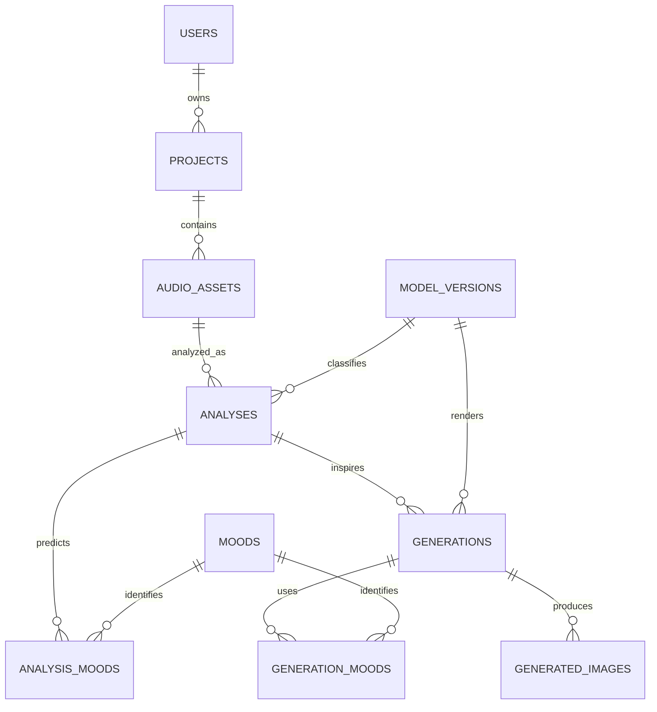

# Synesthesia-AI: full application design

Status: design and roadmap for the local application implemented in `src/web/`.
See `WEB_APP.md` for setup, implemented scope, and verification limits. This extends the original
single-user portfolio scope in response to the CDA application requirement.
The confirmed requirement is a full application with a database and relationships.
No course-specific stack is imposed. AI processing runs locally on the RTX 4090.
The chosen stack is FastAPI, PostgreSQL, SQLAlchemy/Alembic, and HTML/CSS/JavaScript.

## First complete user journey

1. Register, sign in, and create a private project.
2. Upload an audio file and select an excerpt.
3. Start analysis and inspect its progress, calculated features, and mood scores.
4. Select moods and visual settings, then review and edit the generated prompt.
5. Request image generation and inspect progress or a useful failure message.
6. View saved generations, download an image and its reproducibility metadata.
7. Rename or delete a project and its associated stored files.

Accounts and retained project history are implemented additions to the original
MVP. Saving source audio must be explicit; temporary uploads are removed after
processing. An analysis can remain available after its source file is removed,
but rerunning it then requires the original audio.

## Application boundaries

- Web interface: forms, audio excerpt selection, studio, project history, and gallery.
- Backend: authentication, ownership checks, input validation, project operations,
  job submission, and authorized downloads.
- Relational database: application records, foreign keys, constraints, and job state.
  PostgreSQL is the proposed database; the model below does not depend on the UI stack.
- File storage: uploaded audio and generated images; the database stores private
  storage keys and metadata, not public filesystem paths or large binary files.
- Python worker: reuse `src/audio/analysis.py`, `src/ml/inference.py`, and
  `src/generation/` for expensive processing outside HTTP request handlers.

The worker can initially run on the existing GPU machine. Hosting the interface
does not itself provide the Python/GPU runtime required by the AI pipeline.

## Relational model

| Table | Main attributes and constraints |
| --- | --- |
| users | Primary key; unique normalized email; password hash; creation timestamp. Never store plaintext passwords. |
| projects | Primary key; owner foreign key; required title; creation and update timestamps. |
| audio_assets | Primary key; project foreign key; original filename; nullable unique storage key; content checksum; duration; file size; retention choice; deletion timestamp. Metadata survives removal of temporary source audio. |
| model_versions | Primary key; model kind; model identifier; immutable revision or artifact checksum; unique model/revision pair. Covers classifier and diffusion versions. |
| analyses | Primary key; audio asset and classifier version foreign keys; excerpt start/duration; preprocessing version; status; tempo, energy and spectral features; timestamps; safe error details. |
| moods | Primary key; unique label; active flag. Retain historical labels while disabling them for new selections. |
| analysis_moods | Composite primary key `(analysis_id, mood_id)`; two foreign keys; confidence; threshold; detected decision. Confidence and threshold constrained to 0–1. |
| generations | Primary key; analysis and diffusion version foreign keys; final prompt; negative prompt; style; dimensions; inference settings; status; timestamps; safe error details. Freeze inputs when queued. |
| generation_moods | Composite primary key `(generation_id, mood_id)`; selected mood and order. Captures user interpretation separately from classifier output. |
| generated_images | Primary key; unique generation foreign key; private storage key; checksum. Seed and dimensions belong to the generation. |

`analysis_moods` implements the many-to-many relationship between analyses and
moods. `generation_moods` independently records the user's choices, including
moods that were not predicted. The initial implementation produces one image per generation; additional
variations are separate generation requests with their own seeds. Relationships use foreign keys rather than lists of IDs in text.

## Integrity and lifecycle

- Index foreign keys used in ownership checks and project history queries.
- Enforce positive dimensions/durations and nonnegative file sizes and excerpt starts.
  Validate that an excerpt fits the audio duration in the application transaction.
- Define supported job states (`queued`, `running`, `succeeded`, `failed`) and
  enforce valid transitions in the worker. Claim queued work atomically so two
  workers cannot process the same job; recover interrupted work using leases.
- Keep model versions referenced by saved results; restrict their deletion.
- Cascade project-owned database records only on an explicit project deletion.
  Coordinate file deletion through a retryable cleanup process: database cascades
  alone cannot remove files from storage.
- Authorize every record access through its owning project. An authenticated user
  must not read, update, delete, or download another user's records or files.
- Preserve model predictions as recorded. Changes to mood selections create
  generation inputs rather than overwriting the original analysis.
- Preserve existing behavior excluding `inspiring` from new automatic outputs.
- JSON can hold versioned feature vectors and supplemental model settings, but
  users, projects, moods, analyses, and generations remain relational records.

## Implementation milestones

1. Confirm any required course stack; implement database migrations, seed mood
   labels, authentication, project CRUD, and ownership checks.
2. Add validated uploads, excerpt selection, and a worker connected to the real
   analysis pipeline. Display stored predictions in the studio.
3. Add editable generation settings, GPU generation, gallery, downloads, and
   reproducibility exports. Report missing models explicitly, without fabricated results.
4. Complete deletion/retention behavior, accessibility and error handling; verify
   database constraints, user isolation, job recovery, and the full user journey.
5. Prepare setup instructions, schema/migration documentation, architecture and
   sequence diagrams, and test evidence for the assessment.

This document is an application design, not a claim that any specific RNCP rubric
has been satisfied. Map the implemented features to the actual assessment criteria
when the course materials are available.

## Implementation notes

The current schema also contains `sessions` for revocable login sessions and
`file_deletions` for transactional file cleanup. Scientific features and visual
settings use JSON; their parent entities and mood associations use foreign keys.
The initial implementation uses creation timestamps and stored excerpt duration;
additional audit timestamps and original file duration are future extensions.
